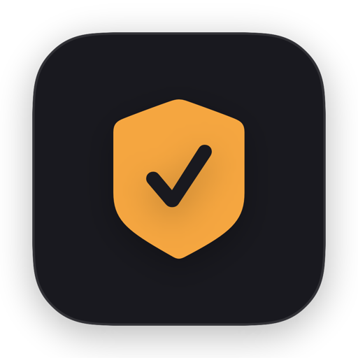
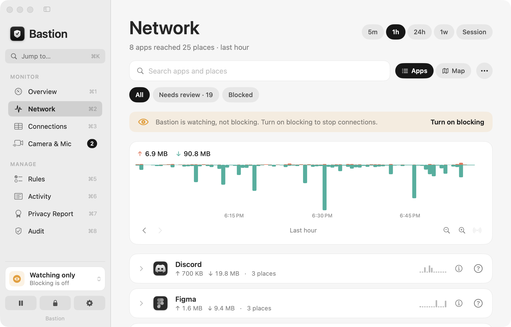
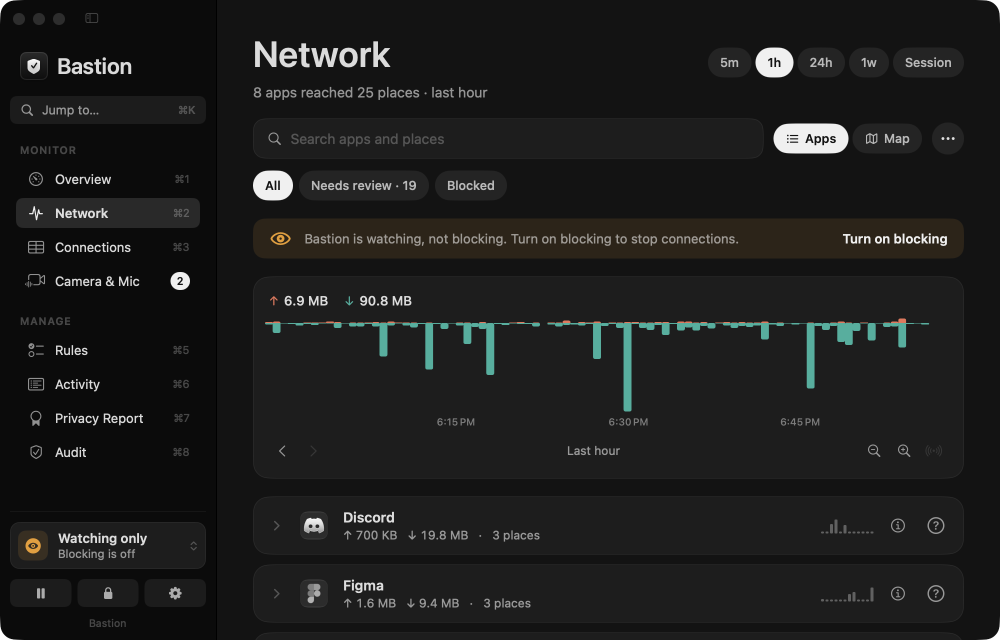
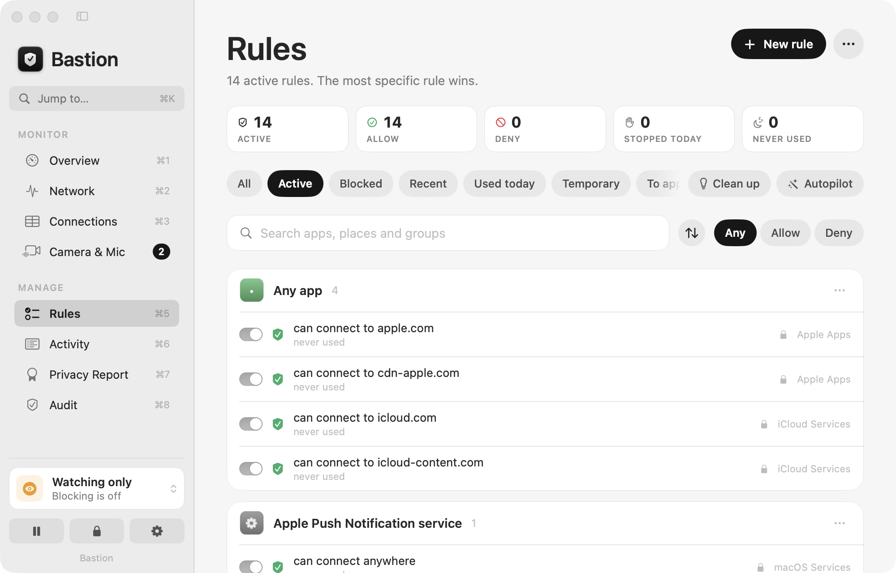
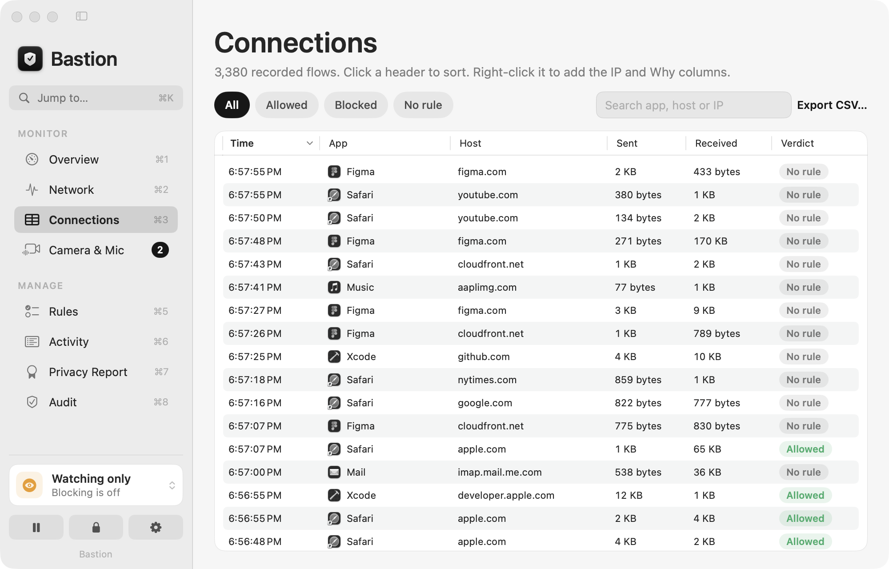
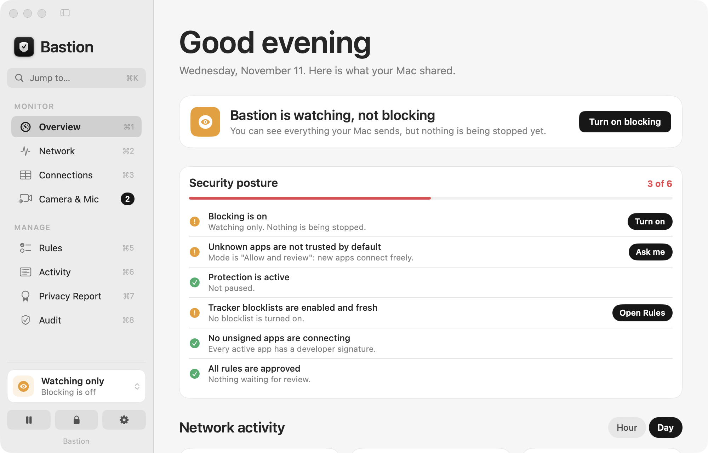
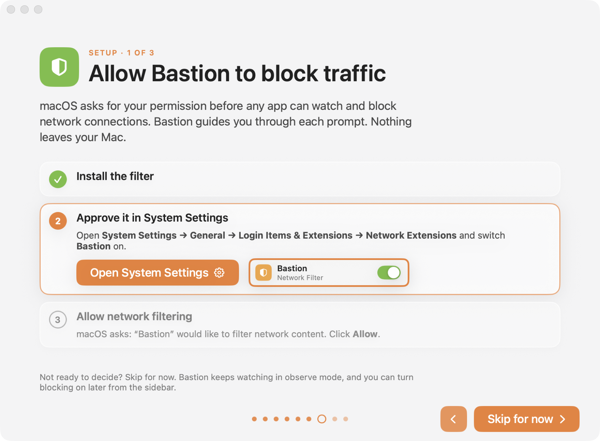

<div align="center">



# Bastion

**See what your Mac shares. Decide what leaves.**

A network firewall and privacy guard for macOS.<br/>
Per-app traffic monitoring, connection rules, and a camera and microphone watchdog, in one native app.


</div>

<br/>

<p align="center">
  
  
</p>

<br/>

## Why Bastion

Every app on your Mac decides for itself where your data goes, and macOS doesn't show you. Bastion does.
It shows who is talking to whom, lets you allow or deny each connection, and tells you the moment anything turns on your camera or microphone.
There is no account and no cloud. Nothing about your traffic leaves your Mac.

## Features

### Network Monitor
- Live traffic per app and per domain, sent and received, with a timeline from 5 minutes to a week.
- System daemons group under **macOS**; subdomains nest under their parent domain.
- Click an app for its path, code signature, team, vendor policy text, connections and map.
- An optional world map shows where each app connects (off by default, see [Privacy](#privacy)).

### Rules
- One-click **allow** or **deny**, per app, per domain, or per port, with durations from *once* to *forever*.
- Rule groups, a **Suggestions** pane that finds redundant, unused and expired rules, and import and export.
- Hosts-format **blocklists** for ads and trackers.
- Every change shows an **Undo** toast.

### Three ways to run

| Mode | What it does |
|---|---|
| **Alert** | Asks before an app contacts a new place. Most control. |
| **Silent Allow** | Allows and records everything. Review later and turn blue buttons into rules. |
| **Silent Deny** | Blocks anything without a rule. Strictest. |

### Camera & Microphone guard
- An overlay and notification the moment any camera or microphone turns on, with a log of who was frontmost and what was uploaded meanwhile.
- Spoken summary on **⌃⌘M**, useful with VoiceOver.

### Built to feel native
- Light and dark appearance, a menu-bar popover with live rates, keyboard shortcuts (**⌘1 to ⌘8** for each page, **⌘K** to jump anywhere, **⌘F**), and a guided first-run setup.

<br/>

<p align="center">
  
  
</p>

<p align="center">
  
  
</p>

## Install

1. Download the latest `Bastion-x.y.z.dmg` from [Releases](https://github.com/BryanParreira/bastion/releases/latest) and drag **Bastion** into **Applications**. It must live there for the network filter to load.
2. Open it. First launch walks you through setup before the app appears.
3. To turn blocking on, finish the two macOS approvals the setup shows:
   - **System Settings → General → Login Items & Extensions → Network Extensions**: switch **Bastion** on.
   - Click **Allow** on *"Bastion would like to filter network content."*

Until then Bastion runs in **observe mode**: it watches and records, but doesn't block.
The toolbar and sidebar always say which mode you're in.

> **Using Little Snitch?** Remove it first. Two content filters at once can conflict.

## How it works

```
┌─────────────────────────┐        XPC (code-signature checked)        ┌────────────────────────────┐
│  Bastion.app (SwiftUI)  │ ◀────────────────────────────────────────▶ │  BastionFilter (system ext) │
│  rules · UI · history   │   rules ▶                      ◀ flow stats │  NEFilterDataProvider       │
└─────────────────────────┘                                            └────────────────────────────┘
```

- **Filter:** a macOS Network Extension (content filter), the same mechanism commercial firewalls use. It evaluates your rules inside the system extension and reports per-flow byte counts.
- **App:** a SwiftUI app that owns rules, history and the interface. Without the filter it falls back to sampling `nettop`.
- **Devices:** camera and microphone state comes straight from CoreMediaIO and CoreAudio "running" flags.
- **Signing:** Developer ID signed, hardened runtime, and notarized by Apple.

## Privacy

- No telemetry, no account, no analytics.
- History, rules and logs stay in `~/Library/Application Support/Bastion` and `~/Library/Logs/Bastion`.
- The only network calls Bastion makes are ones you start: downloading a blocklist, and, if you switch on the map, looking up each server's location (the remote IP address is sent to ipwho.is over HTTPS).

## Status and limits

Bastion is **pre-release**. Being upfront about what isn't there yet:

- Outgoing connections only. Incoming-connection monitoring isn't built yet.
- The network filter depends on you approving it in macOS. Without approval, Bastion is a monitor, not a firewall.
- Updates install automatically (checked daily, signed, and refused if the signature is wrong). You can also check from the Bastion menu.

<br/>

<div align="center">
<sub>Built with SwiftUI and the macOS Network Extension framework.</sub>
</div>
